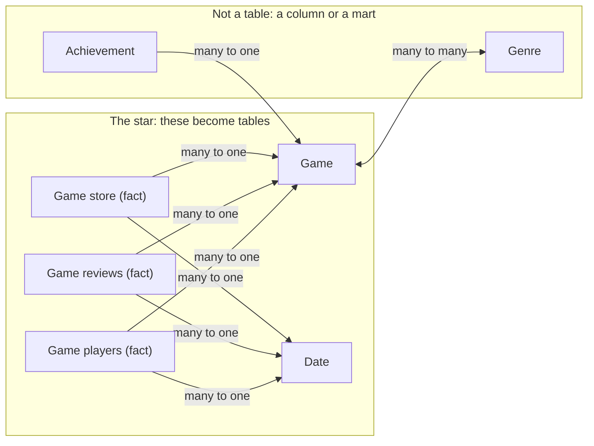
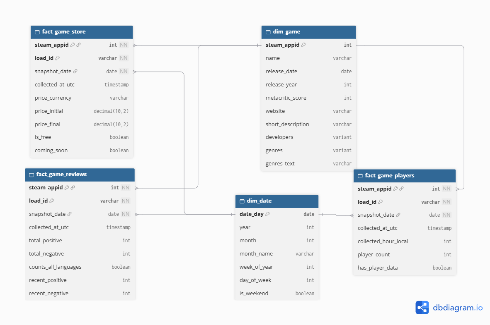

# Conceptual Model and Business Areas: Steam Data Platform

## Overview

This document describes **what the data model is about**, before any tables or columns are built. It lists the things we want to know about (entities), how they connect, and which business questions the data can and cannot answer.

**Status:** Written on 2026-11-05 and updated on 2026-11-06. The two dimensions and the three facts are built and tested ([doc 14](14_dbt_intermediate.md)). The marts are not built yet. On 2026-11-06 the single fact table was split into three, after a tip from my teacher (section 9). Items marked *proposed* are not agreed yet. The decisions in section 9 marked *Agreed* were made on 2026-11-05 and 2026-11-06.

`Steam Data → dlt → STEAM_RAW → dbt Staging → dbt Intermediate (facts and dimensions) → dbt Marts → Streamlit`

Staging is done ([doc 10](10_dbt_sources_staging.md)). The star in the intermediate layer is built ([doc 14](14_dbt_intermediate.md)). This document holds the design of the intermediate layer and the plan for the marts.

## 1. The grain

The grain says what **one row** of the fact table means. It is the most important choice in the model.

| Option | One row is | Problem |
|---|---|---|
| **Per run** *(agreed)* | one game in one collection run | None known |
| Per day | one game on one day | Breaks the first time we run dlt twice on the same day |

**Why per run:** on 2026-11-05 a query on the staging views showed that each `load_id` is shared by all the tables loaded in that run, with exactly 81 rows per table. The newest two runs have it in all four tables. So `steam_appid` + `load_id` finds the matching row in each table. The date alone does not. A player count row has its own time, and a run takes 10 to 20 minutes. **Agreed on 2026-11-05:** every fact has one row per game per run, and the facts are joined on `steam_appid` + `load_id`, not on the date. A second run on the same day then becomes a second row, not a duplicate.

Not tested: a failed run, and two runs in one day. A warning test, `assert_81_games_per_run`, checks that each run has exactly 81 games in each of the three facts. It passed on 2026-11-06 ([doc 14](14_dbt_intermediate.md)).

## 2. Business areas

This replaces the table in the project proposal. It matches what the data can really answer.

| # | Area | Business value: the question | Data used | Limits |
|---|---|---|---|---|
| 1 | **Portfolio overview** | How big is the catalogue? How does it split by genre, release year, price level, free or paid, released or coming soon? | `games` | Genre needs the genre mart. 81 hand-picked games, not all of Paradox. |
| 2 | **Player engagement** | Which games have the most players now? How do player counts change from one run to the next? | `player_counts` | One moment per run, so the hour matters. About 6 runs. No seasons, the history is too short. "No data" is not 0. |
| 3 | **Player sentiment** | How positive are the reviews of one game? How do the last 30 days compare with all time? | `review_summary`, `review_recent` | Before 2026-11-02 the totals count English reviews only. The review count is always shown next to the percent. No ranking of games by percent positive. |
| 4 | **Pricing and discounts** | How do prices and discounts compare? Do games with a discount have different reviews or players? | `games`, reviews, players | We only see discounts that happen on our collection days. **Not checked yet** whether any exist. |
| 5 | **Release lifecycle** | How do newer and older releases compare in sentiment and players? | `games` (release date), reviews, players | Release dates are parsed from text. Unreleased games are left out of comparisons. |
| 6 | **Genre comparison** | How do genres compare? | Same facts, grouped | Genre comes from the mart. Franchise was dropped, see section 9. |
| 7 | **Change over time per game** | How did the reviews and the player count of one game change from one run to the next? | Change between runs, calculated in a mart | Short history, a few weeks, not seasons. Shown on the game page. There is no list of "falling" games. |
| 8 | **Player progression** *(optional) Thinking of dropping this* | How far do players go? What share of players unlock the achievements? | `achievements` | Only 49 of 81 games have achievements. Very few runs so far. |

## 3. Models

Think of a napkin sketch of a house. It shows the rooms and the doors between them. It does not show the size of the windows or the type of floor.

| Model | What it shows | Example here | Where it lives |
|---|---|---|---|
| **Conceptual** | The things and how they connect. No columns. | "A game has many daily snapshots." | This document |
| **Logical** | Columns, keys and links | `fact_game_reviews` has `steam_appid` and `load_id` | Section 6 of this document (drawn on dbdiagram.io, source in `dbt_project/models/intermediate/logical_model.dbml`) |
| **Physical** | The real tables in Snowflake | dbt models in `STEAM_DB` | `dbt_project/models/` |

We go in this order so that the business questions decide the tables, and not the other way around.

## 4. Star schema

| Part | What it holds | Everyday comparison |
|---|---|---|
| **Fact** | Measurements that happened (price, reviews, players) | A receipt line: "on this day, this game had this many players" |
| **Dimension** | Descriptions you filter and group by (game, date) | The labels on the receipt: which shop, which day |

We use a **strict star**: every dimension connects directly to every fact. There are no extra tables between a dimension and a fact, and no dimension links to another dimension. It is simple to read and simple to query.

There are **three facts**, one for each kind of measurement: the store page (price and status), the reviews, and the players. They share the same two dimensions. Each fact with the two dimensions is a star, so the whole model is three stars that share their dimensions. The name for this is a *fact constellation*. It is the usual way to build a model with several kinds of measurements. A fact that mixes them would hold four sources with different histories and different times of collection in one table.

| Fact | One row is | Reads |
|---|---|---|
| `fact_game_store` | one game in one run | `games` |
| `fact_game_reviews` | one game in one run | `review_summary` and `review_recent` |
| `fact_game_players` | one game in one run | `player_counts` |

The three facts have the same grain, so joining them on `steam_appid` + `load_id` gives one row for one row. The `unique` tests on all three facts guard this. Facts are never joined to each other in the star. The mart does it (section 6.4). 

## 5. Entities

| Entity | Type | Plain meaning | Comes from | In the star? |
|---|---|---|---|---|
| **Game store** | Fact | What the Steam store page showed for one game in one run (price and status) | `games` | Yes |
| **Game reviews** | Fact | The review counts of one game in one run, all time and the last 30 days | `review_summary`, `review_recent` | Yes |
| **Game players** | Fact | The player count of one game in one run | `player_counts` | Yes |
| **Game** | Dimension | One Paradox game and the things about it that rarely change | `games` (latest row) | Yes |
| **Date** | Dimension | One calendar day (Stockholm time) | Built by dbt | Yes |
| **Genre** | Concept | A genre label. A game can have several. | `games.genres` (a list) | No. It is split later in a mart. |
| **Achievement** | Concept | One achievement of one game | `achievements` | No. Optional, later. |

### Why Genre is not in the star

A game has several genres, and one genre has several games. This is a **many-to-many** link. A strict star cannot hold it without an extra table.

The genre list stays as a list on the Game dimension. A mart splits it when we need a genre comparison.

| | Tradeoff |
|---|---|
| Good | The star stays simple. No extra tables. |
| Bad | The splitting logic lives in one mart. A second genre question later may repeat it. |
| Rule | A game with 3 genres counts in 3 genre rows. The share of positive reviews per genre is worked out from sums (all positive ÷ all reviews), not as an average of percentages. **Never add the genres together into a portfolio total.** |

## 6. Relationships and logical model

### 6.1 Conceptual relationships

This diagram shows **everything we talk about** in the business. The left box holds the five things that become tables. The right box holds things that are real, but do **not** become their own table.

| Link | Meaning | In the logical model |
|---|---|---|
| Each fact to Game | A game has many rows in each fact, one per run | A link on `steam_appid` |
| Each fact to Date | A day has a row of every game in each fact | A link on `snapshot_date` |
| Game to Genre | A game has several genres | No table. A column, `genres`. A mart splits it. |
| Achievement to Game | A game has many achievements | Not in the model for now |

The conceptual model shows everything we talk about. The logical model (next part) keeps only the star. That is why it looks smaller.

### 6.2 Logical model

The picture shows the star only. The two marts are in the dbml file and are not drawn in the picture.

### 6.3 What changed from the conceptual model to the logical one

| Conceptual | Logical |
|---|---|
| Genre is an entity | No table. It is the list column `dim_game.genres` (plus `genres_text`). The mart splits it. |
| Achievement is an entity | Not in the model for now |
| Game snapshot is one entity | Three fact tables, `fact_game_store`, `fact_game_reviews` and `fact_game_players`, because the measurements come from different sources and have different histories |
| Genre mart | `mart_genre_comparison` stands alone, with no arrow. It reads from the star but is not part of it. |
| Game page mart | `mart_game_detail` also stands alone, with no arrow. It is the table Streamlit reads for one game. |

### 6.4 Columns of each table

The "comes from" column names the staging view the value is taken from ([doc 10](10_dbt_sources_staging.md)). The star (two dimensions and three facts) is built, see [doc 14](14_dbt_intermediate.md). The two marts are *proposed*.

The three facts have the same grain (one game in one run) and the same keys: `steam_appid`, `load_id` and `snapshot_date`. `steam_appid` + `load_id` is unique in each. `snapshot_date` is the Stockholm day and points to `dim_date.date_day`. Counts are stored, percentages are not. A percentage is worked out from sums later, in the mart or the dashboard. A fact has rows only for runs where its source has data, so there are no rows padded with NULL for runs before a table existed.

#### `fact_game_store` (the store page, one game in one run)

| Group | Columns | Comes from | Note |
|---|---|---|---|
| Keys | `steam_appid`, `load_id`, `snapshot_date` | `stg_steam__games` (`steam_appid`, `load_id`, `collected_date`) | |
| Time | `collected_at_utc` | `stg_steam__games` | The time of the `games` row. |
| Price | `price_currency`, `price_initial`, `price_final` | `stg_steam__games` | NULL means no price, never 0. Two released games have no price (known from earlier checks). `discount_percent` is not stored: the mart works it out from the two prices. |
| Status | `is_free`, `coming_soon` | `stg_steam__games` | They can change over time, so they are in the fact and not in `dim_game`. A free game has no price (NULL), so `is_free` is the only way to tell it from a missing price. Two games are free (checked on 2026-11-06, [doc 14](14_dbt_intermediate.md)): *Crusader Kings II* and *Knights of Pen and Paper 2: Free Edition*. Both have a NULL price in all 8 runs. Two other released games, `73020` and `349790`, also have a NULL price but are not free, so `is_free` is what tells the four apart. |

#### `fact_game_reviews` (the reviews, one game in one run)

| Group | Columns | Comes from | Note |
|---|---|---|---|
| Keys | `steam_appid`, `load_id`, `snapshot_date` | `stg_steam__review_summary` | The base of the model is `review_summary`, with a left join to `review_recent` on `steam_appid` + `load_id`. |
| Time | `collected_at_utc` | `stg_steam__review_summary` | |
| Reviews, all time | `total_positive`, `total_negative`, `counts_all_languages` | `stg_steam__review_summary` | The flag is `false` before 2026-11-02 (English only). The total is positive + negative, so it is not stored. |
| Reviews, last 30 days | `recent_positive`, `recent_negative` | `stg_steam__review_recent` | NULL for the runs before 2026-11-02, when this table did not exist. A real 0 stays 0. |

#### `fact_game_players` (the players, one game in one run)

| Group | Columns | Comes from | Note |
|---|---|---|---|
| Keys | `steam_appid`, `load_id`, `snapshot_date` | `stg_steam__player_counts` | |
| Time | `collected_at_utc`, `collected_hour_local` | `stg_steam__player_counts` | Each count has its own time, because a run takes about 10 minutes. The hour tells when the count was taken. |
| Players | `player_count`, `has_player_data` | `stg_steam__player_counts` | NULL means no data, 0 is a real zero. |

#### `dim_game` (one game, latest state, 10 columns)

| Group | Columns | Comes from | Note |
|---|---|---|---|
| Identity | `steam_appid`, `name` | `stg_steam__games` | Latest row per game (this is what `int_steam__games_latest` gives). |
| Release | `release_date`, `release_year` | `stg_steam__games` | `release_year` is worked out in dbt. NULL for unreleased games. |
| Store info | `metacritic_score`, `website`, `short_description` | `stg_steam__games` | Checked on 2026-11-06 over 8 runs: `metacritic_score` did not change for any game, so it stays here ([doc 14](14_dbt_intermediate.md)). If it ever changes, it moves to a fact. |
| Lists | `developers`, `genres` | `stg_steam__games` | Kept as lists. |
| Readable text | `genres_text` | Built by dbt from `genres` | For example "Strategy, Simulation". |

**Dropped from `dim_game` on 2026-11-06:** `type`, `release_date_text`, `required_age`, `platform_windows`, `platform_mac`, `platform_linux`, `publishers` and `categories`. No business area in section 2 asks a question that needs them. A column can be added back with one line in `dim_game.sql`.

#### `dim_date` (one Stockholm day)

Built by dbt from the run days in `stg_steam__games` (one row per day that has a run, no `date_spine`, see [doc 14](14_dbt_intermediate.md)). Columns: `date_day`, `year`, `month`, `month_name`, `week_of_year`, `day_of_week`, `is_weekend`. It is used to group by day, week and month.

#### `mart_genre_comparison` (one genre on one day)

Not part of the star. It reads the three facts and `dim_game`, splits `dim_game.genres` and groups by genre and day. Columns: `genre`, `snapshot_date`, `game_count`, `pct_positive` (all positive reviews of the genre divided by all its reviews), `avg_player_count`, `avg_price_final`. Rules: a game with several genres counts once per genre, and never add genres together.

#### `mart_game_detail` (one game in one run, for the game page)

Not part of the star. It is the table Streamlit reads for one game, because the dashboard reads `MARTS` only. It has the same grain as the facts, one row per game per run. It reads the three facts and `dim_game`. It starts from `fact_game_store` and left-joins `fact_game_reviews` and `fact_game_players` on `steam_appid` + `load_id`, because the other two facts have no rows for the early runs and an inner join would drop those games. The facts store counts, so the percentages and the changes are worked out here. The columns are *proposed*, the dbml has the full list.

| Group | Columns | Note |
|---|---|---|
| Keys | `steam_appid`, `load_id`, `snapshot_date` | `steam_appid` + `load_id` is unique |
| Game | `name`, `genres_text`, `coming_soon`, `is_free` | From `dim_game` and `fact_game_store` |
| Price | `price_initial`, `price_final`, `discount_percent` | NULL means no price, never 0. `discount_percent` is worked out here from the two prices. |
| Reviews | `total_reviews`, `pct_positive`, `recent_total`, `pct_positive_recent`, `counts_all_languages` | The count is always shown next to the percent. A percent is NULL when there are no reviews. |
| Players | `player_count`, `collected_hour_local` | NULL means no data, 0 is a real zero |
| Change since the previous run | `pct_positive_change`, `player_count_change` | NULL when the language flag differs between the two runs, or when a count is missing |

### What changed from the proposal

| Change | Reason |
|---|---|
| **Removed:** Review behavior (playtime, review language, markets) | We load review totals only, not single reviews. This is a data gap, not a modeling one. State it as a limit in the thesis. |
| **Reworded:** "days, weeks or seasons" is now "runs" and "weeks" | The history starts on 2026-10-23. Seasons need months. |
| **Added:** Player progression | The data already exists. It is optional so the thesis does not depend on it. |
| **Sharpened:** Sentiment and Change over time per game (was "Attention areas") | `review_recent` came after the proposal and gives a real "last 30 days vs all time" signal. |
| **Changed:** one fact table became three (2026-11-06) | A tip from my teacher. The four sources have different histories and different times of collection, so each kind of measurement gets its own fact. See section 9. |

## 7. How much history do we have?

Row counts per run. The first query was on 2026-11-05 and gave 6, 5, 4 and 2 runs. It is out of date for all four tables. The numbers below come from CSV exports and a screenshot of read-only queries on 2026-11-06. The `player_counts` row comes from the row count of `fact_game_players` (486 rows in 6 runs), not from a query on the staging view.

| Table | Runs | First run day | Rows per run |
|---|---|---|---|
| `games` | 8 | 2026-10-23 | 81 |
| `review_summary` | 7 | 2026-10-26 | 81 |
| `review_recent` | 4 | 2026-11-02 | 81 |
| `player_counts` | 6 | 2026-10-27 | 81 |
| `achievements` | not in that query | | |

Every run of `review_recent` also has a run of `review_summary` with the same `load_id`, and no run crosses midnight (checked on 2026-11-06). The test `assert_81_games_per_run` passed on 2026-11-06, so each of the three facts has 81 rows in every run.

This is why each fact has rows only for runs where its source has data, and why `games` is the base of the mart. `fact_game_reviews` is built from `review_summary` with a **left join** to `review_recent`, so the early runs are kept and the recent columns stay NULL. The mart starts from `fact_game_store` and left-joins the other two facts.

## 8. Things that are easy to miss

| Topic | What to remember |
|---|---|
| **NULL is not 0** | A missing price, a missing player count and a game without achievements all stay NULL. A real 0 is a real number. |
| **Language switch** | Review totals before 2026-11-02 count English only. A chart of totals jumps on that day. Use `counts_all_languages` in every trend and every change calculation. |
| **Never add up cumulative numbers** | `total_reviews` is a running total. `recent_total` covers 30 days, and two runs share 29 of them. Sum games inside one run, never across runs. |
| **"Now" means the latest run** | Every "current" number on the dashboard uses the newest run only. |
| **Player counts depend on the hour** | Runs happened at different hours of the day. Keep the hour next to the count. |
| **Gaps in the date axis** | Runs are not daily. A line chart would draw a straight line over missing days and look like a trend. Use markers. |
| **Prices** | Prices are in euros (store country Sweden). A free game and a missing price are different things. Decide whether averages include free games. |
| **Percentages** | The facts store the counts, not the percentages. A percentage of totals is correct. An average of percentages treats a game with 3 reviews like a game with 30,000. The dashboard shows the review count next to every percent, and there is no ranking of games, so no minimum is needed (section 9). |
| **Things that change over time** | `coming_soon`, `is_free` and prices live in `fact_game_store`. The Game dimension keeps only things that rarely change, so old rows do not show today's value. |
| **Joining the facts** | The three facts have the same grain, so a join on `steam_appid` + `load_id` gives one row for one row. Start from `fact_game_store` and use left joins, because reviews and players have no rows for the early runs. Do not join facts to each other anywhere else, and do not add numbers across facts. |
| **Time zones** | `snapshot_date` is the Stockholm day. Snowsight shows Pacific time. Use the date column, not the timestamp, for charts. |
| **Completeness test** | A run should have exactly 81 games in each fact. The warning test `assert_81_games_per_run` catches a partial load. It has the 81 written into it. |
| **Correlation** | Reviews and players are indicators, not sales. The thesis shows relationships, not causes. |

## 9. Decisions

| Decision | Status | Reason |
|---|---|---|
| Strict star schema | Agreed | Simple project, simple queries |
| Genre is split in a mart, not stored as a bridge table | Agreed | Fewer tables. The tradeoff is in section 5. |
| Grain is one row per game per run, joined on `steam_appid` + `load_id` | Agreed | Same `load_id` in all tables, supports a second run on one day. A `unique` test on (`steam_appid`, `load_id`) guards it. |
| The facts store counts, not percentages | Agreed (built) | Percentages cannot be added or averaged correctly. The three facts hold counts only. |
| Change between runs (LAG) is calculated in a mart, not in a fact | Proposed | The facts stay as plain measurements |
| Achievements stay out of the star for now | Proposed | Only 49 games, area 8 is optional |
| Facts and dimensions live in the intermediate layer | Agreed | The proposal says so, and the thesis follows the proposal. `fact_game_store`, `fact_game_reviews`, `fact_game_players`, `dim_game` and `dim_date` are built in `INTERMEDIATE`. Marts read from them. **Consequence:** the Streamlit role `STEAM_REPORTER` can read only `MARTS` today (`snowflake_setup/04_grants.sql`), so the dashboard reads marts, not the star directly. So the dashboard gets its data from a mart for the game page (see the next row). |
| Streamlit reads only `MARTS`. A mart `mart_game_detail` serves the game page. No change to Snowflake grants. | Agreed | `STEAM_REPORTER` already has `SELECT` on all current and future tables and views in `MARTS`. `mart_game_detail` is one row per game per run: name, genres, price, review counts, percent positive (all time and last 30 days), player count and change since the previous run. It is a table in `MARTS`, built from the star. The other way, a grant on `INTERMEDIATE`, was not chosen: it would let Streamlit read the star and the prep views directly, make the dashboard code harder and need a Snowflake change. |
| The whole intermediate layer stays a **view** | Agreed | One rule, no exceptions, and `dbt_project.yml` does not change. Views are always fresh, and with 81 games the speed cost is small. Reference repos: the lecture repo made its fact and dimension tables as tables, the Flight repo has no middle layer, so neither is a direct model. **Revisit** and switch the five star models to `table` if Streamlit feels slow. |
| The dashboard shows one game at a time, with no ranking by percent positive and no "attention" list. No minimum number of reviews or players. | Agreed | A single game page compares nothing, so a small sample cannot mislead as long as the count is shown next to the percent. A "few reviews" label is a display choice for later. Checked on the newest run: 70 of 81 games have 100 or more reviews, 40 have 10 or more recent reviews, 46 of 77 have 10 or more players. If rankings are added later, a minimum is needed then. |
| Franchise is dropped from the whole project | Agreed | Steam has no franchise field, so it needs a hand-made list. From the 81 names, about 15 series cover 48 games (my reading, not a query). That is not enough value for the extra work. Area 6 becomes genre comparison only. Can be added later as a seed CSV and one join, without changing any table. |
| **Three fact tables, one for each kind of measurement:** `fact_game_store`, `fact_game_reviews`, `fact_game_players`. The model `int_steam__game_run` (a four-way join) is dropped. | Agreed 2026-11-06 | A tip from my teacher. The four sources have different histories (8, 7, 4 and 6 runs) and different times of collection. One fact would mix them and pad the early runs with NULL. Each fact reads its staging model directly. The star stays strict, because every fact connects straight to both dimensions. The three facts share the dimensions, which makes this a fact constellation (section 4). |
| `dim_game` keeps 10 columns: `steam_appid`, `name`, `release_date`, `release_year`, `metacritic_score`, `website`, `short_description`, `developers`, `genres`, `genres_text` | Agreed 2026-11-06 | Only columns that a business area in section 2 can use. `metacritic_score`, `short_description`, `website` and `developers` were kept on purpose, although no area asks for them yet. |
| `fact_game_store` keeps `is_free` but not `discount_percent` | Agreed 2026-11-06 | The discount can be worked out in the mart from `price_initial` and `price_final`. `is_free` cannot be worked out from anything else: a free game has no price, so without it a free game looks like a missing price. |
| The recent-versus-all-time check is a `warn` test on `fact_game_reviews`. The completeness check is a `warn` test in `dbt_project/tests/`. | Agreed 2026-11-06 | With the split, both numbers of the first check sit in one fact, so it needs no join. The completeness check counts the rows of each run in the three facts. Both passed. |

## 10. Things in the project proposal that no longer match

| In the proposal | Doing |
|---|---|
| "about 82 Steam apps" | 81 games in `GAME_APPIDS` |
| "selected countries and major airports rather than collecting all flights worldwide" | This sentence comes from the Flight-punctuality project. It does not belong in the Steam proposal and should be removed. |
| Review behavior as a business area | Removed, see section 6 |
| "Franchise" comparison (business area and dimension) | Dropped, see section 9. The area is now genre comparison only. |
| Rankings of games by sentiment and a list of games with falling sentiment or players | Not planned. The dashboard shows one game at a time, see section 9. Areas 3 and 7 are reworded to match. |
| "player reviews" as a source | We load review totals only, not single reviews |
| Airflow as Stage 2 | Not decided. Runs are done by hand, once a day at most. |

## 11. Next steps

| Step | What |
|---|---|
| 1 | Agree on the open items in section 9. **Done on 2026-11-05**, no row is marked Open. The grain was agreed too, so two runs on one day are no longer a problem. Rows marked *Proposed* (change in a mart, achievements) are confirmed when we build. |
| 2 | Logical model: drawn on dbdiagram.io (section 6.2). **Done.** |
| 3 | Build the intermediate models (all views): `int_steam__games_latest`, `dim_date`, `dim_game`, `fact_game_store`, `fact_game_reviews` and `fact_game_players`. **Done on 2026-11-06**, `dbt build` gave `PASS=74 WARN=0 ERROR=0` (I saw the last line only). |
| 4 | Build the marts: `mart_genre_comparison` and `mart_game_detail` (one row per game per run, for the game page, starting from `fact_game_store`), because Streamlit reads `MARTS` only |
| 5 | Write the doc for the intermediate layer. **Done**, see [doc 14](14_dbt_intermediate.md). |
