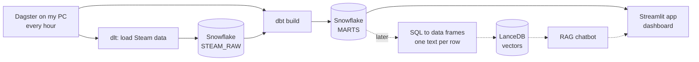

# Plan: Dagster, the Dashboard and What Comes After

**Status (2026-11-23):** this is a plan. Nothing in it is built yet. It goes with [doc 15](15_hourly_runs_plan.md), which has the status list. Doc 15 wins if the two disagree.

## 1. The goal in plain words

I want the pipeline to run **by itself, every hour, 24/7**, so the data keeps coming while I do other things. Then I want a **Streamlit dashboard** with numbers I have checked. After that, I want a **chatbot (RAG)** inside the same Streamlit app. That idea comes from my teacher's drawing and from the AI ops lecture.

The solid lines are the first part. The dotted lines are the chatbot, which comes later.

**My teacher's drawing:** the pipeline and the marts are in Snowflake. The data frames, LanceDB and the RAG are in a second bracket, Azure. Dagster runs on my PC, 24/7, every hour. I cannot tell from the drawing if the Streamlit app is inside the Azure bracket. The note above it says "dashboard + RAG". I decided to keep everything on my PC for now, because the cloud deploy is a lot of extra work.

## 2. What I decided

| Topic | Decision | Source |
|---|---|---|
| Where Dagster runs | On my own PC, which stays on 24/7 | I talked to my teacher |
| Where the data lives | Snowflake (raw data and the marts) | the project plan |
| One hour = one run | All 81 games, all five tables, never a part | [doc 15](15_hourly_runs_plan.md) |
| The dashboard | A Streamlit app that reads the marts as `STEAM_REPORTER`. First on my PC. | this plan |
| Where the app runs | **On my PC. Decided 2026-11-23.** The data and the marts stay in Snowflake. No Azure, Terraform or Docker for now, because the cloud deploy is a lot of extra work. Inside Snowflake stays an option for the dashboard only, if there is time. My PDF said inside Snowflake and the drawing shows Azure, so I tell my teacher. | see 6.2 |
| The chatbot | Later, after Dagster and the dashboard | this plan, see 6.3 |
| Order | Dagster, then check the numbers, then the dashboard, then the chatbot | my teacher |

## 3. What Dagster does here

Three words are enough:

| Word | Meaning | Everyday comparison |
|---|---|---|
| **Job** | The list of steps, in order | A recipe |
| **Schedule** | When the job starts. Mine is every hour. | An alarm clock |
| **Daemon** | The part that watches the clock and starts the schedule | Whoever listens for the alarm |

My job has two steps, and the second only starts if the first worked:

1. **Ingest:** call `run_steam_pipeline()` and then `raise_on_failed_jobs()`, so a failed load is a failed Dagster run.
2. **Transform:** run `dbt build`, so the three marts (they are tables) are fresh.

**Why not one big step per table?** My pipeline already does one full run with one `load_id`. I do not change it ([doc 15](15_hourly_runs_plan.md), section 3).

## 4. The steps

The numbers C1 to C6 are the steps in doc 15, section 4C.

| # | What | Files | I know it worked when |
|---|---|---|---|
| 1 | **Get the PC ready for 24/7.** Sleep and hibernate off, set Windows Update active hours, check the network does not go to sleep. | Windows settings | The PC is still awake after a night |
| 2 | **B1, check the function.** `run_steam_pipeline()` in `pipelines_steam.py` returns the load info. Dagster must call `raise_on_failed_jobs()` on it. | none | **Done on 2026-11-23** (I read the file) |
| 3 | **C1, add Dagster.** A new dependency group `orchestration` with `dagster` and `dagster-webserver`. Look up the current versions then. | `pyproject.toml`, `uv.lock` | `uv run dagster --version` prints a version |
| 4 | **C2, write the definitions.** Two steps (ingest, then `dbt build`), one job, one schedule with the cron `0 * * * *` and the time zone `Europe/Stockholm`. The schedule starts **off**. | `src/steam_data_platform/orchestration/definitions.py` | The job and the schedule show in the Dagster web page |
| 5 | **C3, one run at a time.** A folder for Dagster's own files (`DAGSTER_HOME`) with a `dagster.yaml` that allows one run at a time. | a `dagster_home/` folder | Two clicks on "launch" make the second run wait |
| 6 | **C4, start it with my settings.** `uv run --env-file .env dagster dev`, with `DAGSTER_HOME` set. | none, a command | The web page opens on localhost |
| 7 | **C5, test by hand.** Launch the job once from the web page. Check the new `load_id` has 81 rows in the four raw tables, `dbt build` passes, and the marts have the new run. **Then** turn the schedule on. | none | The check passes, and the next hour starts by itself |
| 8 | **Watch the first 24 hours** (section 5) | none | 24 runs, or I know why one is missing |
| 9 | **C6, clean up.** Remove the empty `orchestration/dags/.gitkeep` and `docker/.gitkeep` if Dagster does not use them. | those two files | They are gone |

**Why `DAGSTER_HOME` matters:** if it is not set, `dagster dev` keeps its history in a temporary folder and throws it away when it stops. Then the schedule would be off again after every restart. A fixed folder keeps it.

**Where the code lives** (open decision 2 in doc 15): my recommendation is inside the package, in `src/steam_data_platform/orchestration/`. It is installed with the project, and one line in `pyproject.toml` tells Dagster where to look.

**Plain steps, not the lab style.** In my labs, Dagster showed dlt and dbt as "assets", a picture of every table. That looks nice, but it needs the names of the dlt tables and the dbt sources to line up, and that is easy to get wrong. I start with two plain steps. If there is time later, I can move to assets for the picture.

## 5. What to watch while it runs 24/7

| Risk | What happens | What I do |
|---|---|---|
| The PC sleeps or restarts | Hours are missing. Dagster does not run the missed hours later. | Missed hours are normal ([doc 15](15_hourly_runs_plan.md), section 6). After a restart I start Dagster again. |
| A run takes more than an hour | The next run waits, so it starts late. `snapshot_hour_local` still shows the real start. | I look at the run times after the first day |
| Steam answers 429 | A run can fail, and a failed run loads nothing | I look for 429 in the Dagster logs. If they come, I slow down first. |
| Snowflake credits | Every hour wakes the warehouse, and the dashboard uses it too | I check the credit balance after the first day and after the first week |
| `dagster dev` is a development tool | If it stops, the schedule stops | It is fine for the thesis. I write it as a limit. |
| A `dbt build` that fails | The run is marked failed in Dagster | I read the dbt log in the run. A `warn` test does not fail the run. |

## 6. After Dagster: the dashboard and the chatbot

### 6.1 Check the numbers

I check **every number on the dashboard** against a SQL query on the marts. Three examples for the first version:

| Dashboard number | How I check it |
|---|---|
| Games in the newest run | 81 |
| Price bands in the newest run | the sums of `mart_portfolio_overview` (on 2026-11-20: 27, 19, 16 and 11, plus 6 and 2) |
| One game's change since the previous run | one game by hand, like Stellaris in [doc 16](16_dbt_marts.md) |

The rules from my docs stay: a missing value is never 0, the review count is always next to the percent, nothing is added up across runs, and genres are never added together.

### 6.2 The Streamlit app: where does it run?

**First step, no decision needed:** build it as a normal Streamlit app on my PC. It reads the marts as `STEAM_REPORTER`. The packages are already in `pyproject.toml` (the `dashboard` group: `streamlit` and the Snowflake connector). This is the fastest way to check the numbers.

**Decided on 2026-11-23: everything runs on my PC.** The cloud deploy would be a lot of extra work. The options below stay as notes, in case there is time later.

| Option | Good | Careful |
|---|---|---|
| Inside Snowflake (my PDF) | Everything stays in one place, with the same roles | I must check the Snowflake docs: which packages exist there, and whether an app inside Snowflake can call a chatbot model and a vector database outside |
| Azure, only when needed (my teacher's drawing, and my Flight lab) | Fits the chatbot. I deploy it with Terraform for a test or the presentation, then take it down. The data stays in Snowflake, so nothing is lost. | The vector database lives in the container, so it must be built again after each deploy, or kept in storage. More work (Docker, Terraform). |
| A front end in Docker on my PC (like the Flight lab) | Free. The same Docker setup can later go to Azure. | Only I can see it, and only while the PC is on |
| Only a plain Streamlit app on my PC | Free and quick | Only I can see it, and only while the PC is on |

**If the vector database, the RAG, the dashboard and the chatbot can all run inside Snowflake, I need no front end outside.** I do not know yet if they can. Snowflake has its own search and language-model features, but I have not checked them, or what my account allows and what it costs. I find out when I start the chatbot.

The first step is the same for all options. Neither of my lab repos shows an app deployed inside Snowflake.

### 6.3 The chatbot (RAG)

**What the AI ops lecture did** (repo `ai_ops_lecture`, lecture 11 and 12). I read the main files on 2026-11-23, with a helper, not every file.

| Step | In the lecture | In my project (the idea) |
|---|---|---|
| The text | 4 PDF files turned into text files | Rows of the marts turned into text with SQL (my teacher's drawing: SQL, then data frames) |
| The "source field" | The text column that LanceDB turns into a vector | The text column of each data frame |
| Embedding | A Gemini embedding model, called by LanceDB when rows are added. This is a paid API. | The same idea. The model is not chosen. |
| Vector database | LanceDB in a local folder | The same, in a folder first |
| The RAG | An agent with a tool that searches LanceDB and answers only from what it found | The same |
| The app | A FastAPI backend and a Streamlit front end, started together with Docker compose | A chat part inside my Streamlit app |
| Deploy | Docker compose on the PC. I found no Azure files in the repo. | I still have to learn this |

**What I must think about before I start:**

1. **A vector search finds text that is similar. It is not good at numbers.** "Which game has the most players now?" is a SQL question. If the chatbot only searches text made from the marts, it can answer numbers badly. My idea, which is **not** from the lecture or the drawing: give the chatbot two tools. One searches text (game descriptions, and what each column means from docs 13 and 16). The other runs a read-only SQL query on the marts. I ask my teacher about this.
2. **Wrong numbers become wrong answers.** So the chatbot comes after the numbers are checked.
3. **The data changes every hour.** Making the vectors again every hour costs API calls and time. The lecture waits 30 seconds between documents because of rate limits. With about 100 texts, that is far too slow. I would only embed what changed, and I check the limits of the paid plan.
4. **Cost and keys.** The calls are paid. The keys stay in `.env` and never go into git.
5. **My dashboard rules also apply to the chatbot.** I decided on no ranking of games. A chatbot asked to rank games would break that. Not decided.
6. **Scope.** The chatbot is not in my PDF and not in the 220-hour estimate. I ask my teacher if it is required or a bonus.

**If I do it, the steps are:** (R1) decide what text to make from the marts, (R2) build the data frames with SQL, (R3) put them into LanceDB, (R4) build the RAG agent, (R5) add a chat box to the Streamlit app, (R6) add a third Dagster step that updates the vectors after `dbt build`, (R7) deploy. Dagster can get the third step later, so the plan in section 4 does not block it.

## 7. What my two lab repos showed me

I read the Dagster parts of both repos on 2026-11-23. I did not read every file.

| | Aira lab | Flight-punctuality lab |
|---|---|---|
| Steps | dlt and dbt as assets, two jobs | dlt and dbt as assets, one job for all assets |
| Schedule | a cron without a time zone, dbt starts when the dlt asset is done (a sensor) | a cron with the time zone `Europe/Stockholm` |
| Start | `dagster dev -f` with a file | `uv run dagster dev` |
| Settings | a local secrets file | `.env` with `uv run --env-file .env` (the same as mine) |
| One run at a time | not found | not found |
| Streamlit in Snowflake | not found (the app runs locally) | not found (the app runs separately) |

**What I take:** the cron with `Europe/Stockholm`, and `uv run --env-file .env dagster dev`. **What is new for me:** the one-run-at-a-time setting and the persistent `DAGSTER_HOME`. I check both in the current Dagster docs when I write them.

## 8. Not decided

| Question | Note |
|---|---|
| Plain steps or assets | I start with plain steps. See section 4. |
| Where the code lives | Recommended: inside the package |
| Where the Streamlit app runs | Decided: on my PC. Inside Snowflake, for the dashboard only, is an option for later. See 6.2. |
| Is the chatbot required or a bonus? | Ask my teacher. See 6.3. |
| What the chatbot can answer | Text only, or also numbers with a read-only SQL tool. See 6.3. |
| A freshness check (a warning when the newest run is more than 2 hours old) | Later, not part of the minimum |
